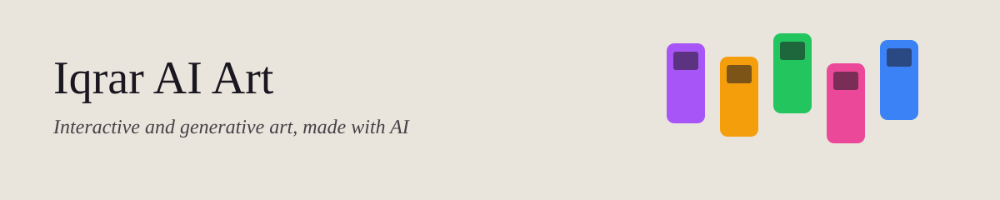
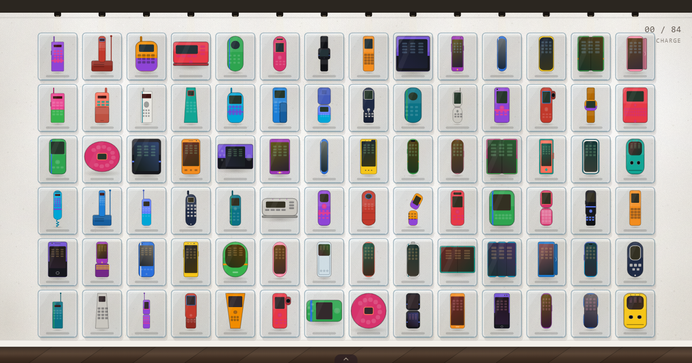

# Iqrar AI Art

Interactive and generative art by Iqrar Rizvi, made with AI. Concepts and direction are mine; the code and the sound are written by Claude. Each piece is one page that you play with in a browser, with nothing to install.

**[Open the Art Site](https://rizvihiqrar.github.io/iqrar-ai-art/)** | [About](https://rizvihiqrar.github.io/iqrar-ai-art/#about) | **[Technical guide →](TECHNICAL.md)**

*Lost Tones: tap a phone and it rings its own ringtone.*

## Pieces

| Piece | What it is | Open |
|---|---|---|
| [**Lost Tones**](pieces/01-lost-tones.md) (2026) | A quiet white gallery wall of eighty-four made-up phones, from a 1983 brick to the folding phones of today. Tap a phone and it rings its own ringtone. | [Play it](https://rizvihiqrar.github.io/iqrar-ai-art/lost-tones/) in a desktop browser, with the sound on |

## At a Glance

- One hand-made page per piece: HTML, CSS and JavaScript, no install and no files to download
- Sounds are made in the browser as you play
- The site around the pieces uses the same look as my [product](https://rizvihiqrar.github.io/product-portfolio/) and [training](https://rizvihiqrar.github.io/training-portfolio/) portfolios, with dark mode
- Checked at phone width (360 and 390 pixels) before each change, with the rules pinned in the tests

## Credit and Copyright

AI-assisted and AI-generated art. Concepts and direction by Iqrar Rizvi. Code and sound by Claude (Anthropic).

Copyright 2026 Iqrar Rizvi. All rights reserved. The pieces may be viewed here, but may not be copied, reused or redistributed without permission.
